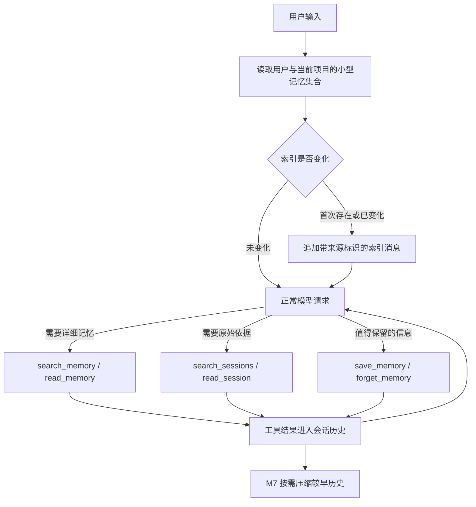

# 长期记忆与会话追溯

> 状态：M9 已实现文件记忆、按需召回、历史追溯与管理界面；无 embedding、后台整理任务或数据库迁移。

## 1. 职责

`AGENTS.md` 保存明确工作规则，仍由用户或团队主导维护。Memory 保存跨会话有价值的偏好、用户纠正、项目背景和资料线索。实现事实与正式设计仍以项目文档为准，提示条款要求模型不重复保存已有说明或能从代码恢复的事实。

用户记忆跨工作区可见，项目记忆按工作区规范化绝对路径的 SHA-256 前 24 位标识隔离。Session ID、消息位置和 Run ID 是来源，不是记忆归属。移动目录、仓库子目录和不同 worktree 暂不自动归为同一个项目。

原始历史和整理后的记忆分别保留。需要核对原话时使用会话读取工具；跨项目历史必须显式指定目标工作区，并由提示条款要求用户提出相应请求。这是行为约定，不是账户或操作系统安全隔离。

## 2. 保存与管理

模型通过 `save_memory` 在当前交互中保存值得保留的信息；用户明确要求记住时，也走同一个工具。保存、更新和遗忘遵循现有 `ask/auto/full` 审批：`ask` 会询问，`auto/full` 可直接执行。默认启用，用户可在 Memories 界面关闭模型的读取和写入；关闭不禁止用户在管理界面手动编辑。

本阶段没有每轮额外的模型提取调用，也不后台扫描全部聊天。是否值得保存由主模型判断。自动保存的准确性仍需真实模型验收，不能把提示条款视为严格保证。

文件存储的具体路径、字段和限额见 [Memory 参考](../reference/memory.md)。每条记忆原子替换，跨进程文件锁串行化写入；更新与遗忘要求当前内容版本，过时版本报错，避免多个会话覆盖修改。完全相同的标题和内容再次新建时返回已有记录；不会进行语义去重。

`forget_memory` 将条目移出活动集合并保留本地退役副本；原始聊天也保留。用户看到明确提示后确认遗忘。它不承诺安全擦除，也不改写旧消息。

## 3. Context 与 M7

Server 在每次 Run 开始时读取有数量和大小限制的记忆文件，生成短索引。它不扫描工作区文档，不做向量检索。相比只在新会话加载一次，这个检查能让已打开会话发现记忆被更新或遗忘。

首次有记忆时，在用户消息之前追加标为 `Saved memory index (application data)` 的 assistant 数据消息。版本变化时追加替代通知；没有变化则不重复。索引和通知随普通消息持久化，稳定 system 前缀与既有历史不改写。协议没有专用应用数据角色，因此使用有明确标识的 assistant 文本；UI 将其标为 Memory update，不将其当成新的用户要求。

索引只提供标题、范围与 ID，正文由模型通过工具读取。未列出的条目可用 `search_memory` 分页查询。旧索引不保证及时，提示要求使用当前条目、让明确指令和当前项目文件优先。

读取结果进入正常历史；M7 压缩历史时不修改记忆源文件，摘要遗漏细节后仍能重新读取。索引本身也可能被压缩，模型仍有搜索工具。更新和关闭最迟在下一次 Run 公布；已经发出的请求和历史内容不会被撤回。

## 4. 分层与边界

- `core/memory.py` 定义数据、存储端口和索引追加规则，无文件或数据库 I/O。
- `adapters/memory.py` 实现 Markdown 文件存储；`adapters/tools/memory.py` 提供受限记忆操作。
- 会话工具通过既有 Repository 读取 Session、Run 和消息；不新增数据库表。
- Bootstrap 装配存储和工具，Server 编排历史与来源，客户端仅访问 HTTP API。
- 普通文件工具仍拒绝 workspace 越界。记忆工具只访问装配好的专用记忆目录，不能传入任意路径；拒绝记忆存储内部的符号链接。
- 新写入的明显凭据模式会被拒绝，读取边界继续脱敏；这不能识别所有敏感信息。被召回的内容会进入所选模型的请求。

## 5. 验收与遗留

自动测试覆盖跨会话保存与召回、重开存储、项目隔离、来源位置、只读与写入审批、关闭开关、输出限制、并发冲突、损坏文件、符号链接、历史分页、跨项目显式范围、M7 压缩后重读，以及 UI 编辑/遗忘/来源/冲突提示。

首版不包含 embedding、后台历史提炼、按 Git 仓库合并项目、跨项目记忆库搜索、自动合并冲突、完整版本历史或彻底抹除。Server 历史检索不涵盖直连 CLI 的独立 transcript；CLI 默认远端模式与桌面、Web 使用同一套 Server 能力。直接恢复模式可读写文件记忆，来源保留其 transcript 的 Session ID 和消息位置。

真实模型仍需验证：是否恰当地保存与召回、是否重复记忆、是否遵守用户纠正，以及额外工具调用对延迟和输入量的影响。
