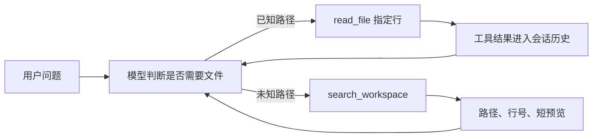

# 工作区检索设计

> 状态：M8 已实现按需词法检索；embedding 留待检索质量评估后决定。

## 1. 目标与边界

模型在任务需要工作区信息、但尚不知道文件位置时，主动调用 `search_workspace`。工具返回少量带路径和行号的文本预览；模型可再用 `read_file` 按行读取原文。普通问题不扫描工作区。检索与读取结果是正常工具消息，写入 Session 历史，后续轮次可以复用。

M8 不下载 embedding 模型、不调用 embedding API、不新增数据库表或持久索引。工作区边界是工具规则，不是操作系统沙箱。

## 2. 工具流程

`search_workspace(query, path, max_results)` 的 `path` 可选，能把搜索缩小到工作区内某个文件或目录；`max_results` 默认 5，最多 10。模型可换关键词或缩小路径重试。若模型没有调用搜索工具，Runtime 不会预扫或注入任何文件片段。已知路径时直接使用 `read_file`，不要求先搜索。

`WorkspaceRetriever` 在工具执行时扫描允许的文本扩展名，按最多 36 行、1600 字符切片，相邻片段重叠 4 行。英文标识符、下划线词和中文双字片段参与路径与正文匹配；每个文件最多返回两个不重叠片段，候选最多 12 个。工具结果每条只给 320 字符预览，总输出最多 3200 字符，仍受 `ExecutionContext.max_output_chars` 限制。文件变化会在下一次工具调用时可见。

扫描最多读取 1500 个文件、8 MB 正文，单文件最多 256 KB；使用 `ExecutionContext.default_timeout_seconds` 控制扫描期限。隐藏路径、常见生成目录、锁文件、名称显然包含密钥的文件、二进制文件和 workspace 外的符号链接目标会被跳过。结果经过现有脱敏函数；脱敏无法保证识别所有敏感信息，选中的预览与后续 `read_file` 正文会发给模型。

## 3. Context、历史与缓存

搜索结果先作为 `tool` 消息加入 `AgentState.messages`，Server 写入现有 Session 消息表，直连 CLI 写入 transcript；后续轮次从历史重建模型请求。工具输出会占用 Context，但不会像临时注入那样在下一轮从历史中消失，因此更利于跨轮前缀缓存复用。搜索只在模型调用工具时发生，需要多一次模型与工具往返。

M7 在配置了上下文窗口且请求超限时，压缩较早的完整轮次；原始历史仍保留，模型请求改用摘要。**当前用户轮次的工具结果不能靠 M7 立即压缩**。Runtime 在只读工具执行后检查“当前轮次 + 稳定前缀 + 工具 schema”的估算下限；若结果本身放不下，保存一条安全工具错误，提示缩小请求或减少输出。此检查不将已经执行的写入操作伪装成失败。近似预算不能保证 Provider 的精确 token 计算；较早的大轮次也可能使 M7 的摘要请求无法装入窗口。摘要可能丢失代码细节，需要时模型可按路径重新读取。

## 4. 关键决策

- 由模型决定是否搜索；不在每个 Run 开始时扫描工作区。
- 代码与项目文档先使用本地词法检索；是否增加 embedding 由实际漏检决定。
- 搜索只返回定位线索与短预览，精读交给已有 `read_file`。
- 工具结果进入历史；M7 负责较早轮次的压缩，当前轮次依靠小结果与窗口检查。
- 每次搜索重新读取文件，不持久化索引；大仓库的扫描上限可能漏掉后面的文件。

## 5. 验收

- 没有搜索工具调用时，不发生工作区扫描。
- 模型可以搜索未知路径，再按行读取；已知路径可以直接读取。
- 搜索与读取结果在后续轮次的模型请求中可见。
- 越界路径、隐藏路径与工作区外符号链接无法通过搜索读取。
- 当前轮次的超长工具结果会变成可恢复的工具错误，不把原文塞进溢出的请求。
- Server、直连 CLI 使用同一工具注册，不新增数据库 schema。

## 6. 后续

用中文语义问题、代码符号和跨文件问题组成固定查询集，评估命中率、工具调用次数、延迟、缓存命中与答案质量。若词法检索漏掉同义表达，再评估 embedding、混合检索或持久索引。
